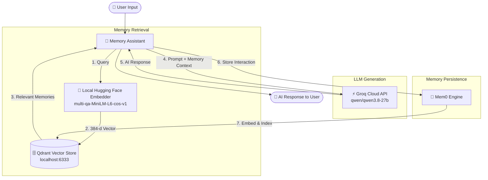

<div align="center">

# 🧠 AI Memory Assistant

### A Persistent, Context-Aware AI Agent with Long-Term Memory
Built with **Mem0**, **Groq LLM**, **Local Hugging Face Embeddings**, and **Qdrant Vector Database**.

[](https://www.python.org/)
[](https://groq.com/)
[](https://mem0.ai/)
[](https://qdrant.tech/)
[](https://huggingface.co/)
[](LICENSE)

---

</div>

## 📖 Overview

Standard LLMs are **stateless** — every time you start a new conversation, they forget who you are, your preferences, and past instructions. 

This project solves this by creating an **AI Memory Assistant** that retains long-term memory across sessions. It intelligently recalls relevant memories whenever you ask a question and stores new facts automatically into a local vector database.

### 🌟 100% Free & Open-Source Stack:
- **No OpenAI Key Required:** Uses high-speed inference on **Groq Cloud**.
- **No Paid Embedding API:** Uses **Hugging Face Sentence-Transformers** locally on your machine for free with zero rate limits.
- **Persistent Local Database:** Stores high-dimensional vector embeddings in **Qdrant** via Docker.

---

## 🏛️ System Architecture



---

## ✨ Features

- **⚡ Lightning-Fast Inference:** Powered by Groq's LPUs for near-instant responses.
- **🔍 Semantic Memory Recall:** Retrieves relevant past facts using cosine similarity in Qdrant.
- **💻 Lightweight Local Embeddings:** `multi-qa-MiniLM-L6-cos-v1` (~80MB) runs locally without hitting cloud rate limits or consuming API quotas.
- **👤 Multi-User Isolation:** Scoped with `user_id` so different users have separate, private memory profiles.
- **🎨 Interactive Terminal UI:** Built with [Rich](https://github.com/Textualize/rich) for formatted markdown output and memory inspection commands.
- **🛡️ Rate-Limit Proof:** Optimized to work within Groq free-tier constraints without token exhaustion errors.

---

## 📂 Project Structure

```text
mem0-ai-assistant/
│
├── config.py             # Central configuration (loads environment & Mem0 settings)
├── memory_agent.py       # Object-oriented MemoryAssistant class
├── main.py               # Interactive CLI chat application with Rich UI
├── docker-compose.yml    # Docker configuration for local Qdrant Vector DB
├── requirements.txt      # Python dependencies
├── .env.example          # Environment variables template
├── .gitignore            # Git exclusion rules (protects API keys & storage)
└── README.md             # Project documentation
```

---

## 🚀 Quickstart Guide

### 1. Prerequisites
Ensure you have the following installed:
- [Python 3.10+](https://www.python.org/downloads/)
- [Docker Desktop](https://www.docker.com/products/docker-desktop/) (must be running)
- A free [Groq API Key](https://console.groq.com)

### 2. Clone the Repository
```bash
git clone https://github.com/Rohit18457/mem0-ai-assistant.git
cd mem0-ai-assistant
```

### 3. Create and Activate a Virtual Environment
```bash
# Windows
python -m venv .venv
.venv\Scripts\activate

# macOS / Linux
python3 -m venv .venv
source .venv/bin/activate
```

### 4. Install Dependencies
```bash
pip install -r requirements.txt
```

### 5. Setup Environment Variables
Copy `.env.example` to `.env`:
```bash
cp .env.example .env
```
Open `.env` and paste your Groq API key:
```env
GROQ_API_KEY=gsk_your_actual_groq_api_key_here
```

### 6. Start the Qdrant Vector Database
Start Qdrant in the background using Docker Compose:
```bash
docker compose up -d
```
> Verify it's running by visiting [http://localhost:6333/dashboard](http://localhost:6333/dashboard) in your browser.

### 7. Run the Assistant!
```bash
python main.py
```
*(Or alternatively: `python mem.py`)*

---

## 💬 Example Interactive Session

```text
============================================================
🧠 AI Memory Assistant
Powered by Mem0 + Groq (qwen/qwen3.8-27b) + HuggingFace + Qdrant
👤 Active User: rohit_suryawanshi
Commands: /memories (list all), /exit (leave)
============================================================

You: Hey! My name is Rohit and I love building AI agents in Python.
AI: Hello Rohit! It's awesome to meet you. Python is a fantastic language for building AI agents. What kind of agents are you currently working on?
Memory has been saved.
----------------------------------------

You: What is my favorite programming language?
[Context] Retrieved 2 relevant memories.
AI: Based on what you shared earlier, your favorite programming language is Python!
Memory has been saved.
----------------------------------------

You: /memories
┌───┬────────────────────────────────────────────────────────┬─────────────────────┐
│ # │ Memory Snippet                                         │ Created At          │
├───┼────────────────────────────────────────────────────────┼─────────────────────┤
│ 1 │ Hey! My name is Rohit and I love building AI agents... │ 2026-11-11T11:05:12 │
│ 2 │ Hello Rohit! It's awesome to meet you...               │ 2026-11-11T11:05:14 │
└───┴────────────────────────────────────────────────────────┴─────────────────────┘

You: /exit
Goodbye! Have a great day!
```

---

## ⚙️ Configuration Reference

All settings can be customized in `.env` without modifying the source code:

| Variable | Default Value | Description |
| :--- | :--- | :--- |
| `GROQ_API_KEY` | *(Required)* | Your Groq Cloud API key |
| `GROQ_MODEL` | `qwen/qwen3.8-27b` | Groq chat completion model |
| `QDRANT_HOST` | `localhost` | Qdrant server host |
| `QDRANT_PORT` | `6333` | Qdrant server port |
| `QDRANT_COLLECTION` | `mem0_hf` | Vector collection name |
| `EMBEDDING_MODEL` | `multi-qa-MiniLM-L6-cos-v1` | Hugging Face embedding model |
| `EMBEDDING_DIMS` | `384` | Embedding vector dimensionality |
| `DEFAULT_USER_ID` | `rohit_suryawanshi` | Default user ID (no spaces) |

---

## 🛠️ Common Issues & Troubleshooting

### 1. `Vector dimension error: expected dim: 1536, got 384`
- **Cause:** Qdrant's default collection was initialized for OpenAI embeddings (1536 dimensions), but Hugging Face models output 384 dimensions.
- **Solution:** This repository uses `collection_name="mem0_hf"`, which automatically configures the collection for 384-dimensional vectors.

### 2. `Invalid user_id: cannot contain whitespace`
- **Cause:** Mem0 requires user IDs to be valid slugs without spaces.
- **Solution:** Use underscores or dashes (e.g., `rohit_suryawanshi` instead of `Rohit Suryawanshi`).

### 3. `Error code: 413 - Request too large... Limit 7000`
- **Cause:** Mem0's automatic extraction prompt is ~8,200 tokens, which exceeds Groq's free-tier input limits for some preview models.
- **Solution:** Our implementation uses `infer=False` in `mem0.add()`, computing embeddings locally via Hugging Face and bypassing Groq token consumption completely during memory writes.

### 4. Docker Qdrant connection refused
- **Solution:** Run `docker compose ps` to check container status, or restart with `docker compose restart`.

---

## 🤝 Contributing

Contributions are welcome! Please feel free to submit a Pull Request.

1. Fork the Project
2. Create your Feature Branch (`git checkout -b feature/AmazingFeature`)
3. Commit your Changes (`git commit -m 'Add some AmazingFeature'`)
4. Push to the Branch (`git push origin feature/AmazingFeature`)
5. Open a Pull Request

---

## 📄 License

Distributed under the **MIT License**. See `LICENSE` for more information.

---

<div align="center">
Built with ❤️ for the AI Developer Community.
</div>

